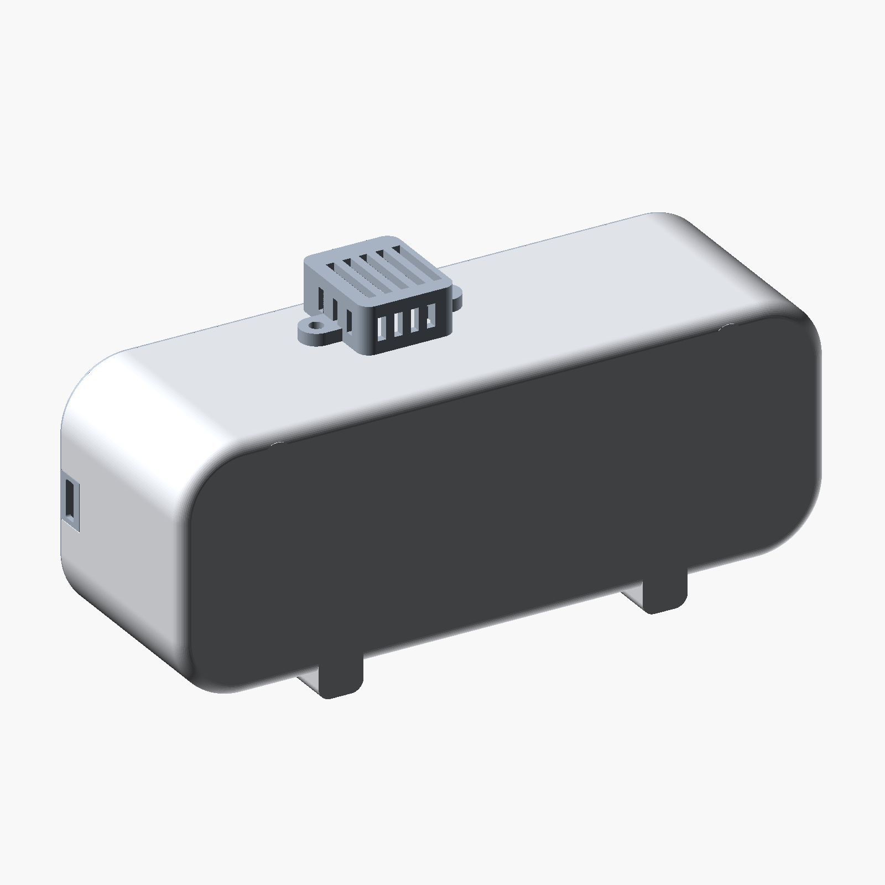
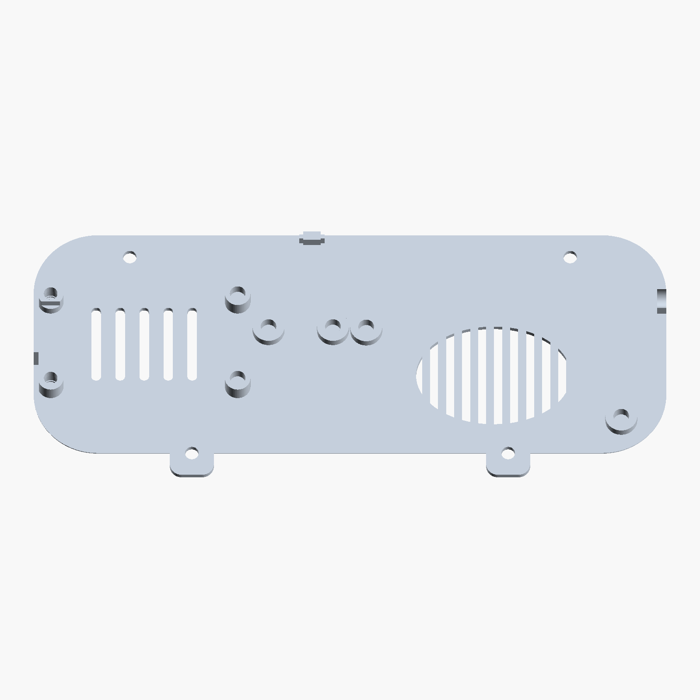

# ESP32 Smart Clock enclosure

Rounded, three-part enclosure by **NirBY**, design revision **18**. This folder contains the current design only. Units: **millimetres**. Scale: **100%**.



**Read before printing the lid:** two M3 inserts must be installed during a print pause. Use **0.15 mm for the first layer and all later layers**; pause **after Z = 4.05 mm, before Z = 4.20 mm**. The finished posts cannot accept those inserts from outside because their rear openings are closed by an integral **0.6 mm** skin.

## Printable files

| File | Quantity | Function | Orientation |
|---|---:|---|---|
| [body.stl](stl/body.stl) | 1 | Shell, two feet and light diffuser | Front face on bed, as supplied |
| [lid.stl](stl/lid.stl) | 1 | Rear cover and electronics mounts | Outside face on bed, as supplied |
| [sensor_cage.stl](stl/sensor_cage.stl) | 1 | External ventilated sensor cage | Flat slotted face on bed, as supplied |

Optional samples: [ESP mounts](test-pieces/esp_gauge.stl) and [USB power opening](test-pieces/power_gauge.stl). These are test pieces, not additional assembly parts.

See the illustrated [print and assembly guide](PRINT_GUIDE.pdf) and and [publishing instructions](publication/PUBLISHING.md).

## Design

- Smooth rounded profile with two feet and four lid screws; two screws are integrated into the feet.
- Continuous **0.6 mm front diffuser**, with four separate L-shaped display stops.
- Side-accessible ESP USB-C, D-shaped post relief beside its buttons, and centered rear vents.
- Oblong power USB-C opening on the opposite short side, beside the speaker and close to the lid.
- Speaker held by two diagonal screws, low amplifier mounts alongside it.
- External sensor cage with opposing screws and a concealed cable route. The PCB rests loose inside.
- Built-in **0.6 mm closures** behind two recessed ESP insert pockets; no extra cover part.

Body: **158 x 60 x 49.7 mm**. Overall, including lid, feet and cage: **158 x 77.5 x 51.2 mm**. Nominal walls: **2.25 mm**. Lid: **1.5 mm**. ESP seating height above inner lid: **5 mm**. Nominal display-to-ESP connector clearance: **5.1 mm**.

## Compatible hardware

Compare actual parts with [measurements.json](measurements.json); boards sharing a chip name may have different dimensions. Measurements have approximately +/-1 mm uncertainty.

| Component | Measured dimensions / details |
|---|---|
| MAX7219 8x32 display | 132.1 x 32.1 x 17.8 mm, including connected wiring |
| ESP32 USB-C, 30-pin CH340C-style board | PCB 51.6 x 28.2 mm; length with USB 53.5 mm; wired depth 23 mm; four 3.1 mm holes centered 2.45 mm from each adjacent edge |
| Speaker | 69.7 x 31.2 x 16.6 mm; ears 1.7 mm thick; holes 3.3 mm; central membrane 38.7 x 26.9 mm |
| NS4168 I2S amplifier | PCB 38.5 x 22.4 x 1.5 mm; wired length 42.4 mm; height 10.1 mm; holes 4.7 mm |
| AHT20 / BMP280 board | 15 x 15 x 7.6 mm including connector; no M3 screws through its PCB |
| Snap-in USB-C power socket | Body 12.8 x 5.2 mm; depth behind flange 12.7 mm; spring span up to 15.7 mm; flange 15.6 x 9.3 mm |

Power aperture: **13.1 x 5.5 mm**, oblong, long axis along enclosure depth. Test its sample first. Existing interconnect wires are approximately **200 mm**. See the [project repository](https://github.com/NirBY/ESP32_Smart_Clock) for wiring and ESPHome firmware.

## Fasteners

Use **14 M3 brass inserts**, **2.9 mm** long, maximum outside diameter **4.2 mm**, root diameter about 3.7 mm. Modeled pilot diameter: 3.9 mm. Screw heads: flat underside, diameter 5.2 mm, height 2.1 mm.

| Location | Count | Screw / washer |
|---|---:|---|
| Lid to body | 4 | M3 x 5 with 0.5 mm washer, or M3 x 4 without washer |
| Sensor cage | 2 | M3 x 6 |
| ESP USB-side posts | 2 | M3 x 8 with 0.5 mm washer; inserts installed during printing |
| Other ESP posts | 2 | M3 x 5 |
| Speaker | 2 | M3 x 5 with 0.5 mm washer |
| Amplifier | 2 | M3 x 5 with 0.5 mm washer; washer outer diameter 7 mm |

Confirm screws clamp before bottoming. ESP PCB thickness of 2.5 mm is inferred; USB-side M3 x 8 screws with 0.5 mm washers have about 0.9 mm nominal clearance above the closed skin.

## Print settings

Designed for PLA and Ender-3 V3 KE. Use calibrated filament temperatures, cooling and speeds. No machine-specific G-code is included.

| Part | Material | First / later layers | Requirement |
|---|---|---|---|
| Body | **White PLA** | 0.20 / 0.20 mm | At least three fully solid bottom layers through the diffuser |
| Lid and ESP sample | PLA | **0.15 / 0.15 mm, fixed** | Pause after 27 completed layers, at Z 4.05 mm |
| Cage and power sample | PLA | 0.20 / 0.20 mm | Inspect small openings and bridges in slice preview |

Suggested starting point: 0.4 mm nozzle, three perimeters, 20% infill. These are starting settings, not a validated slicer profile. Inspect bridges and overhangs; keep support out of insert pockets, vents and cable passages. Do not auto-rotate the lid, add a raft, or use adaptive layers with the specified pause. The creator successfully tested the 0.6 mm diffuser in white PLA; opaque black PLA blocked the LEDs.

## Mandatory lid pause

1. Print the ESP sample first, in the supplied orientation, with fixed 0.15 mm layers including the first.
2. Add the printer-supported pause **after completing Z 4.05 mm, before Z 4.20 mm**. This is after 27 layers; verify height, since slicer indices differ.
3. Heat-set the two 2.9 mm M3 inserts into the open USB-side pockets. The 3.9 mm pilot is smaller than the 4.2 mm insert: do not force it in cold. Keep the part attached to the bed.
4. Each insert rests on the shoulder at Z 1.05 mm. Its top should be **Z 3.95 mm**, about 0.10 mm below the paused surface. Verify it is below the nozzle path.
5. Resume printing the narrower screw-access section above the inserts. Install other accessible inserts after printing and cooling.

The pause and heat-setting workflow is geometrically checked but **not physically validated** for this revision. Test the sample before printing the full lid.

## Assembly

1. Let the body cool before release; avoid pushing on the thin diffuser. Install its lid and cage inserts.
2. Place the display face against the diffuser between the four L stops. There are no display screws or snap arms.
3. Mount the ESP, amplifier and speaker to the lid. ESP USB faces the left port; speaker membrane faces the rear grille and its wires lead toward the amplifier.
4. Seat the power socket in the opposite side opening with the lid open, its long axis along enclosure depth.
5. Route the connected wiring, placing sensor wires through the body opening inside the cage footprint. Close the lid without pinching wires and fit four screws.
6. Rest the sensor on the outside of the body and secure its cage with two opposing screws. Do not screw through the sensor PCB.



## Validation and source

The three main STLs are watertight, consistently wound, single connected solids. Checks cover component envelopes, insertion paths, ports, vents, corner stops, D relief and the two 0.6 mm rear closures. JSON reports accompany the source. Exact button contours, spring behavior and flexible wiring still require physical fitting; the complete latest assembly has not been print-verified.

With Python 3.13 recommended, run from the repository root:

```sh
python -m pip install -r ESP32_Smart_Clock_3D_Design/requirements.txt
python ESP32_Smart_Clock_3D_Design/validate_all.py
```

To regenerate, install OpenSCAD on PATH or set `OPENSCAD` to its executable:

```sh
python ESP32_Smart_Clock_3D_Design/export_stl.py body lid sensor_cage esp_gauge power_gauge
python ESP32_Smart_Clock_3D_Design/validate_all.py
python ESP32_Smart_Clock_3D_Design/package_release.py
```

Packages are written to this folder's `dist/`: final STLs, GitHub source, and Creality upload materials. No firmware or private configuration is included.

## License

Copyright (c) 2026 NirBY. **CC BY-NC-SA 4.0** for the enclosure and accompanying files. See [ATTRIBUTION.md](ATTRIBUTION.md) and [LICENSE](LICENSE). Firmware elsewhere in the repository is outside this license's scope.

## Print configuration

[Ender-3 V3 KE / white PLA native 3MF](print-profiles/ESP32_Clock_Ender3V3KE_PLA_015mm.3mf) includes all three parts, 0.15 mm layers and the required insert pause. [Read settings and limitations](print-profiles/README.md). Slice-checked; not physically printed.
