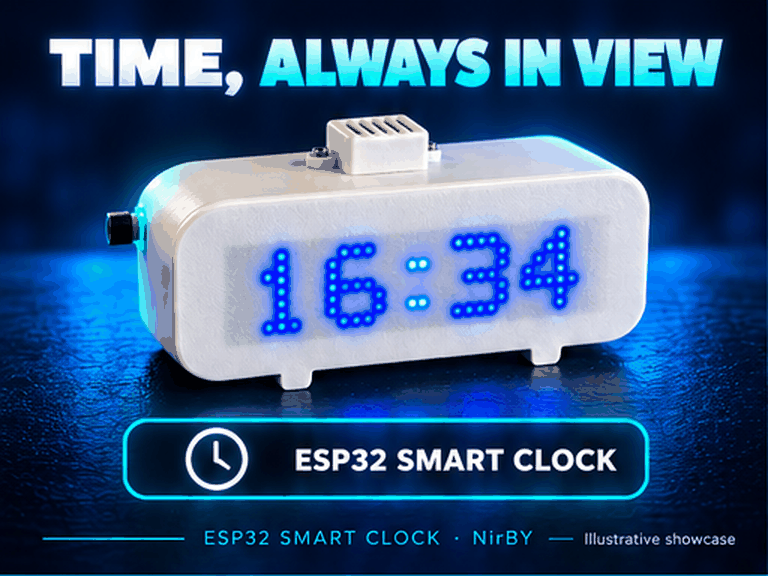
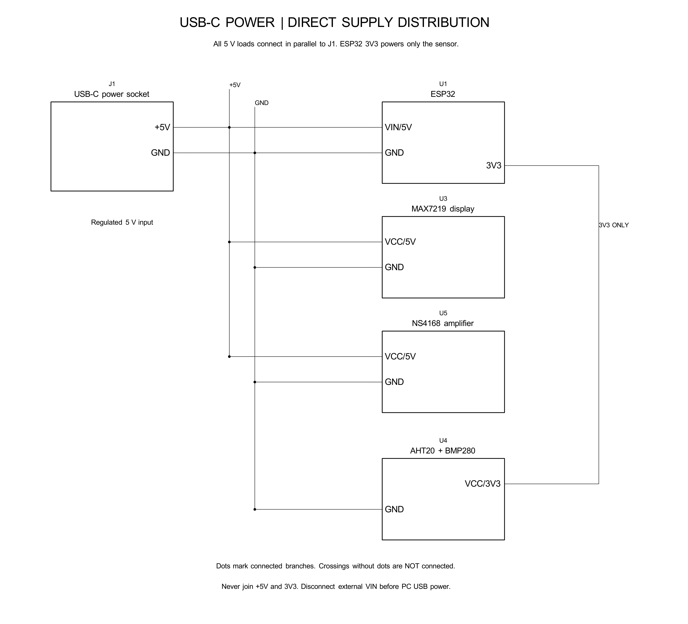
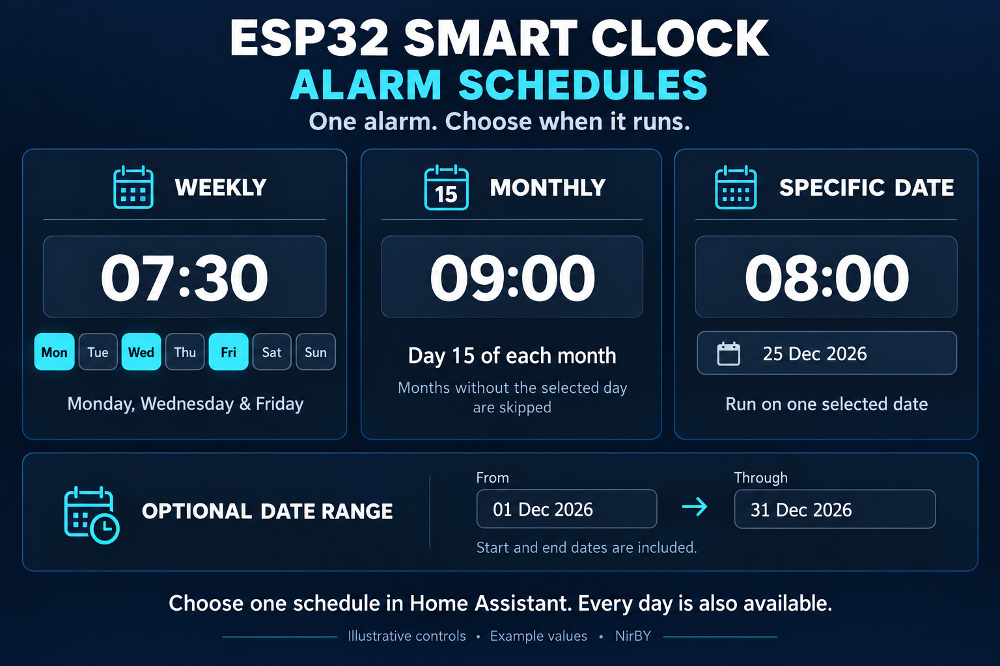
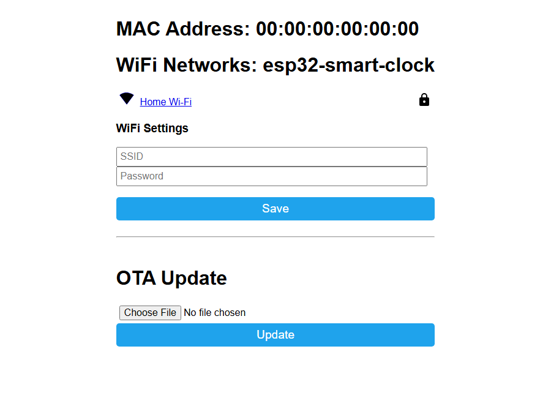

# ESP32 Smart Clock

Release `0.1.0-beta.19` uses HA-compatible firmware versions and rejects development suffixes that make HA incorrectly show **Up-to-date**. Clocks running versions such as `beta.15-dev.3` need one personalized update from their local YAML; afterward, HA can correctly compare newer releases and enable **Update**. Public binaries still use example credentials. The blueprint notification links directly to the firmware update panel. Weekly, monthly, and specific-date alarms are covered in the [alarm guide](docs/wiki/Alarm.md).

Release `0.1.0-beta.15` added a local countdown with a dedicated
Home Assistant Timer device, configurable countdown/clock display intervals,
and sliding transitions. See [Timer controls and behavior](docs/wiki/Timer.md).
ESPHome is pinned to 2026.10.0. The countdown completion melody was installed
and audibly approved on the creator's clock. The optional HA MCP script package
still requires installation and end-to-end MCP testing.

[](docs/wiki/Gallery.md)

*Eight-feature animated showcase. Displays and enclosure illustrations are promotional; [actual build photos](docs/wiki/Gallery.md#actual-printed-clock) and [static slides](docs/images/showcase-storyboard.png) are available. Optional MCP scripts require setup.*

[Full wiring diagram](docs/wiki/Wiring.md) · [Parts and purchase links](docs/wiki/Shopping-List.md) ·
[Photo and STL gallery](docs/wiki/Gallery.md) · [Home Assistant MCP tools](docs/home-assistant-mcp/README.md)

ESP32 smart clock project with an 8x32 MAX7219 LED matrix, AHT20/BMP280 indoor sensors, an NS4168 I2S audio amplifier module, and Home Assistant control through ESPHome.

For normal use, install the **ESPHome smart clock firmware** from `esphome-smart-clock.yaml`.

## AI control with Home Assistant MCP

**MCP runs in Home Assistant, not on the ESP32.** An authenticated AI client calls
Home Assistant tools; HA sends commands to the clock through the ESPHome API.
The optional [MCP package](docs/home-assistant-mcp/README.md) is included in this
repository and adds six tools:

| Tool | What you can do |
|---|---|
| Status | Read temperature, humidity, pressure, timer, alarm and settings |
| Timer | Start a countdown, pause, resume or cancel it |
| Alarm | Daily, weekly, monthly or specific-date schedules, with optional date limits; [alarm guide](docs/wiki/Alarm.md) |
| Message | Display custom text (up to 100 characters) or clear it |
| Setting | Change brightness, display intervals, switches and time format |
| Music | Search/play through Music Assistant; control playback and volume |

### Set up MCP

1. Add the clock to Home Assistant through the **ESPHome integration** first.
2. Review the entity IDs in [package.yaml](docs/home-assistant-mcp/package.yaml)
   against your installation. Copy it to `/config/packages/esp32_clock_mcp.yaml`.
   Enable packages under your existing `homeassistant:` configuration, check
   configuration and restart HA. The [installation guide](docs/home-assistant-mcp/README.md#install)
   includes the YAML and an alternative using six individual scripts.
3. In each of the six scripts, open **Settings → Voice assistants** and expose
   it to **Assist**.
4. Add/configure the **Model Context Protocol Server** integration. Select the
   **Assist** LLM API and keep authentication enabled. Review other entities
   already exposed to Assist, since they may also be available to the client.
5. In **Settings → System → AI**, enable the appropriate MCP server and copy
   its URL into your MCP-compatible AI client. Sign in with Home Assistant using
   supported authentication. A remotely hosted client needs a reachable HA URL.
   See the [official HA MCP setup](https://www.home-assistant.io/integrations/mcp_server/).
6. Reconnect the client, check that the clock tools appear, then ask for status,
   display a test message and run a short timer. Check HA script traces and the
   physical clock to confirm execution.

Try: “Show HELLO on the clock”, “Start a seven-minute timer”, “Show the countdown
for 10 seconds and the time for 2 seconds”, “Set the daily alarm to 07:30”, or
“What are the room temperature and humidity?”

Music search requires **Music Assistant** and configured music providers. MCP
does not automatically mirror Google Home timers or add a microphone to the
clock. This package is supplied for setup and testing; **end-to-end control
through a live MCP client has not yet been verified**.

## Complete wiring

**Power distribution:** USB-C directly supplies every 5 V load and common ground. Only the sensor VCC uses ESP32 3V3.



**Signal connections:**

[](docs/images/wiring.png)

[High-resolution PNG](docs/images/wiring.png) · [Scalable SVG](docs/images/wiring.svg) · [Two-sheet PDF](docs/hardware/clock-wiring.pdf) · [Editable KiCad source](docs/hardware/clock-wiring.kicad_sch) · [Pin mapping and assembly notes](docs/wiki/Wiring.md)

Connections use module labels and firmware GPIO numbers, not physical header positions. The diagram includes the display, external sensor, amplifier, speaker, USB-C power and shared ground.

## Printable enclosure

The [current three-part enclosure](ESP32_Smart_Clock_3D_Design/README.md) includes the final [body](ESP32_Smart_Clock_3D_Design/stl/body.stl), [lid](ESP32_Smart_Clock_3D_Design/stl/lid.stl) and [sensor cage](ESP32_Smart_Clock_3D_Design/stl/sensor_cage.stl), editable source, fit samples and an [illustrated assembly guide](ESP32_Smart_Clock_3D_Design/PRINT_GUIDE.pdf). Only the latest design is retained in the working tree.

**The enclosure opens from the back.** The front diffuser is part of the body;
remove the vented rear lid to access the electronics.

| Assembled enclosure | Rear lid removed |
| --- | --- |
|  |  |

*CAD views rendered directly from the supplied STL meshes. Open the
[body](ESP32_Smart_Clock_3D_Design/stl/body.stl),
[rear lid](ESP32_Smart_Clock_3D_Design/stl/lid.stl), or
[sensor cage](ESP32_Smart_Clock_3D_Design/stl/sensor_cage.stl) on GitHub to rotate
the actual 3D model.*

Print the body in white PLA for the tested 0.6 mm diffuser. The creator has printed and assembled the working clock in one continuous print. The enclosure files are licensed **CC BY-NC-SA 4.0** by NirBY; see the [design license scope](ESP32_Smart_Clock_3D_Design/ATTRIBUTION.md).

## Alarm schedules

Configure one alarm in Home Assistant: every day, selected weekdays, a day of
each month, or a specific date. Optionally limit it to an inclusive start/end
date range. The schedule summary shows your choices in readable text.

[](docs/wiki/Alarm.md)

*Illustrated examples of the scheduling controls, not a live Home Assistant
screenshot. Choose one schedule at a time. The
[example dashboard](docs/home-assistant-dashboard.yaml) shows the relevant
weekday switches, day-of-month control, or date picker for your selection.*

See the [alarm setup and scheduling rules](docs/wiki/Alarm.md). The clock displays
`ALARM` and sends an event to Home Assistant; use an HA automation for sound or
other actions.

## Quick Start

Follow [local setup for Windows, macOS or Linux](docs/wiki/Local-Setup.md) first. Run commands from your cloned repository root with the appropriate environment active. `CLOCK_DEVICE` means your actual USB port or network hostname/IP.

1. Clone the repository and create the ESPHome environment using the linked setup guide (tested ESPHome: `2026.10.0`).
2. Copy `secrets.example.yaml` to `secrets.yaml`.
3. Put your Wi-Fi and ESPHome API key in `secrets.yaml`.
4. Connect the ESP32 with a USB data cable.
5. Compile and upload:

   ```sh
   esphome compile esphome-smart-clock.yaml
   esphome upload esphome-smart-clock.yaml
   ```

6. Add the discovered ESPHome device in Home Assistant.

If upload fails, hold **BOOT** while upload starts, then release **BOOT** when writing begins.

## Recover Wi-Fi from your phone

The clock already includes **ESP32 Smart Clock Fallback**, a password-protected
Wi-Fi hotspot and setup page. No Bluetooth, app, Home Assistant connection, or
USB cable is needed to change the router name/password.

**Default password for public release firmware:** `CHANGE_ME_FALLBACK_AP_PASSWORD`
(type it exactly, including underscores). This is an example placeholder, not a
password generated for each clock. For your own build, replace
`fallback_ap_password` in your private `secrets.yaml` before flashing. If you
already flashed a personalized build, use the password you configured there.

1. Power the clock normally. If its configured Wi-Fi network cannot be reached
   (for example, after changing the router password), wait **90 seconds**.
   The fallback hotspot starts automatically; there is no button to press.
2. On your phone, open **Settings > Wi-Fi** and join
   **ESP32 Smart Clock Fallback**.
3. Enter the hotspot password: the value of `fallback_ap_password` in your
   private `secrets.yaml`. This is separate from your home Wi-Fi password.
   Public release builds use the example value `CHANGE_ME_FALLBACK_AP_PASSWORD`.
4. Accept **Stay connected / Use without Internet** if prompted. If the setup
   page does not open automatically, open **http://192.168.4.1/** in your browser
   (HTTP, not HTTPS). Temporarily turn off mobile data or a VPN if your phone
   keeps routing away from the clock.
5. Select your home **2.4 GHz** Wi-Fi network, or enter its name manually, enter
   its password, and press **Save**. The ESP32 board used here cannot join 5 GHz.
6. Allow the clock to connect, then reconnect your phone to your normal network.
   The fallback hotspot shuts down after connection. If the password is wrong,
   reconnect to the fallback hotspot and try again.



*Screenshot of the original ESPHome 2026.9.0 portal rendered locally with
example network data. Your available networks will differ.*

The portal saves the new credentials on the clock across restarts. Also update
`wifi_ssid` and `wifi_password` in your local `secrets.yaml` before the next USB
build/upload, so a future firmware installation does not restore stale values.
Changing Wi-Fi here does not change the Home Assistant API encryption key.

To test recovery without changing your router, temporarily flash a local build
with a nonexistent Wi-Fi SSID, wait 90 seconds, then follow the steps above.
Keep a copy of your correct local settings. Do not reset or erase the device.

Reference: [ESPHome captive portal documentation](https://esphome.io/components/captive_portal/).

## Firmware Updates

For a personalized clock, update from your local ESPHome YAML. This preserves
your private `secrets.yaml` and any local config edits:

```sh
esphome run esphome-smart-clock.yaml --device CLOCK_DEVICE
```

Replace `CLOCK_DEVICE` with the clock IP address.

The GitHub release update entity checks public release binaries. Those binaries
are built in GitHub Actions with `secrets.example.yaml`, so they are useful as
reference/recovery artifacts but are not the normal update path for a device
that needs your local Wi-Fi/API secrets.

[](https://my.home-assistant.io/redirect/blueprint_import/?blueprint_url=https%3A%2F%2Fgithub.com%2FNirBY%2FESP32_Smart_Clock%2Fblob%2Fmain%2Fdocs%2Fblueprints%2Fautomation%2Fesp32_smart_clock_auto_update.yaml)

The button imports a safe check/notify blueprint. It does not install public
GitHub firmware unless you explicitly enable that option.

Each update notification includes **Open firmware update panel**, which opens
the selected clock's update details in your own Home Assistant instance.
Opening the link does not install firmware. Re-import the blueprint to add
the link to an existing automation. The panel uses the entity's reported
status; older development builds may still show **Up-to-date** despite the
notification. Personalized clocks still need firmware built with their own
configuration and credentials.

## Calendar Agenda Announcements

Home Assistant can read today's events from a calendar, print a compact agenda
on the LED matrix, and optionally speak the same agenda through the clock
speaker. The automation can run every day at a selected time, from an
`input_button` helper, or both.

[](https://my.home-assistant.io/redirect/blueprint_import/?blueprint_url=https%3A%2F%2Fgithub.com%2FNirBY%2FESP32_Smart_Clock%2Fblob%2Fmain%2Fdocs%2Fblueprints%2Fautomation%2Fesp32_smart_clock_calendar_agenda.yaml)

Create an `input_button` helper if you want a dashboard button, then import the
blueprint and select your calendar, clock speaker, and ESPHome display action.

## Tested software versions

Download the enclosure on [Creality Cloud](https://www.crealitycloud.com/model-detail/6adbce3bd4b1f991f82d5813).
The listing was submitted on October 24, 2026 and is subject to platform review.

| Component | Version |
|---|---|
| Clock firmware | 0.1.0-beta.15 (tested locally as beta.15-dev.3) |
| ESPHome | 2026.10.0 (see `ESPHOME_VERSION`) |
| PlatformIO Core (ESPHome build environment) | 6.2.0 |
| PlatformIO Core (separate Arduino builds) | 6.2.0 |
| Arduino PlatformIO platform | pioarduino 55.03.312-1 |
| Arduino-ESP32 / ESP-IDF | 3.3.12 / 5.5.5 |
| ESP32-A2DP | 1.8.11 |
| Adafruit AHTX0 / BMP280 / GFX | 2.0.6 / 3.0.0 / 1.13.0 |
| MD_MAX72XX | 3.5.1 |

The ESPHome firmware uses its own supported ESP-IDF toolchain. The Arduino
platform above is used for the separate hardware-test and Bluetooth builds.
Release CI installs the exact version in `ESPHOME_VERSION` and builds with
`secrets.example.yaml`; private local firmware binaries must not be published.

## Firmware Options

| Firmware | Use for | Home Assistant | Wi-Fi | Bluetooth music |
|---|---|---:|---:|---:|
| ESPHome smart clock | Clock, sensors, screen messages, alarm, Home Assistant speaker | Yes | Yes | No |
| Bluetooth speaker | Direct Bluetooth music from phone/PC | No | No | Yes |
| PlatformIO hardware test | Checking wiring and modules | No | No | No |

The ESP32 runs one firmware at a time. Flashing the Bluetooth speaker firmware replaces ESPHome. Flashing ESPHome again replaces the Bluetooth speaker firmware.

## Hardware Summary

- ESP32 30-pin dev board, CH340C, USB-C, HW-394 style board
- MAX7219 8x32 LED matrix
- NS4168 I2S Class-D audio amplifier module with speaker
- AHT20 + BMP280 I2C temperature, humidity, and pressure board
- 5V 3A USB-C power supply

Main pins:

| Function | ESP32 pin |
|---|---:|
| I2C SDA | GPIO21 |
| I2C SCL | GPIO22 |
| MAX7219 DIN | GPIO23 |
| MAX7219 CLK | GPIO18 |
| MAX7219 CS/LOAD | GPIO5 |
| I2S DATA | GPIO25 |
| I2S BCLK | GPIO26 |
| I2S LRCLK/WS | GPIO27 |

All module grounds must be connected together.

## Wiki

Detailed documentation was moved out of the README:

- [Wiki Home](docs/wiki/Home.md)
- [Hardware And Power](docs/wiki/Hardware-And-Power.md)
- [Install And Home Assistant](docs/wiki/Install-And-Home-Assistant.md)
- [Home Assistant Dashboard](docs/wiki/Home-Assistant-Dashboard.md)
- [Calendar And Announcements](docs/wiki/Calendar-And-Announcements.md)
- [Display Behavior](docs/wiki/Display-Behavior.md)
- [Audio And Music](docs/wiki/Audio-And-Music.md)
- [Logs And Troubleshooting](docs/wiki/Logs-And-Troubleshooting.md)
- [Development And Releases](docs/wiki/Development-And-Releases.md)

## Common Commands

Open logs over USB:

```sh
esphome logs esphome-smart-clock.yaml --device CLOCK_DEVICE
```

Upload and keep logs open:

```sh
esphome run esphome-smart-clock.yaml --device CLOCK_DEVICE
```

Upload an already compiled firmware over Wi-Fi by IP address:

```sh
esphome upload esphome-smart-clock.yaml --device CLOCK_DEVICE
```

Upload over Wi-Fi by IP address and keep logs open:

```sh
esphome run esphome-smart-clock.yaml --device CLOCK_DEVICE
```

For the separate Arduino builds, activate the [PlatformIO environment](docs/wiki/Local-Setup.md#separate-platformio-environment), then run:

```sh
python -m pip install "platformio==6.2.0"
```

Build the PlatformIO hardware test:

```sh
pio run -e esp32dev
```

Build the Bluetooth speaker firmware:

```sh
pio run -e bluetooth_speaker
```

## Notes

- Do not commit `secrets.yaml`; it is ignored by git.
- `GPIO5` is an ESP32 strapping pin. It is currently used for MAX7219 CS/LOAD, so avoid external pull-up/down effects on that pin.
- Hebrew MAX7219 font glyphs can be designed with [md_max72xx-font-designer](https://github.com/vasco65/md_max72xx-font-designer/tree/master).
- For audio noise or playback issues, see [Logs And Troubleshooting](docs/wiki/Logs-And-Troubleshooting.md) and [Audio And Music](docs/wiki/Audio-And-Music.md).
