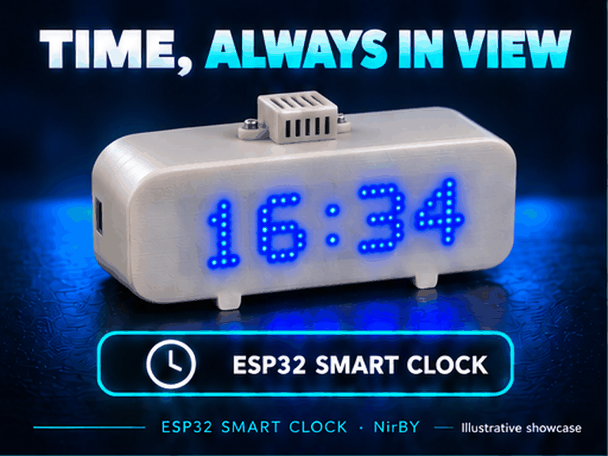
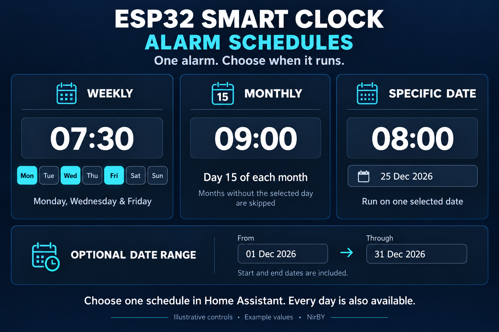
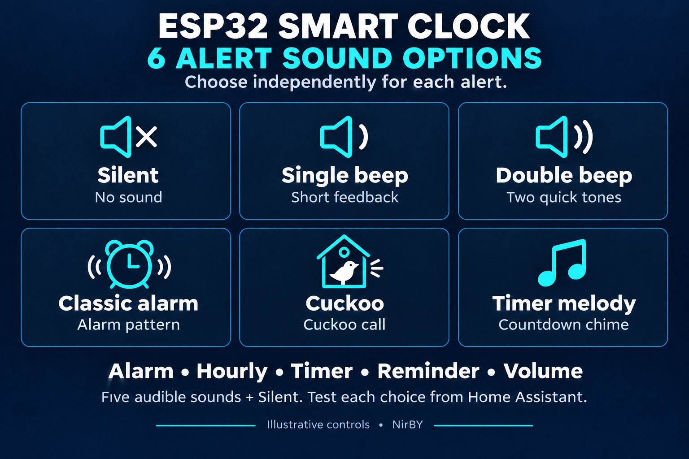
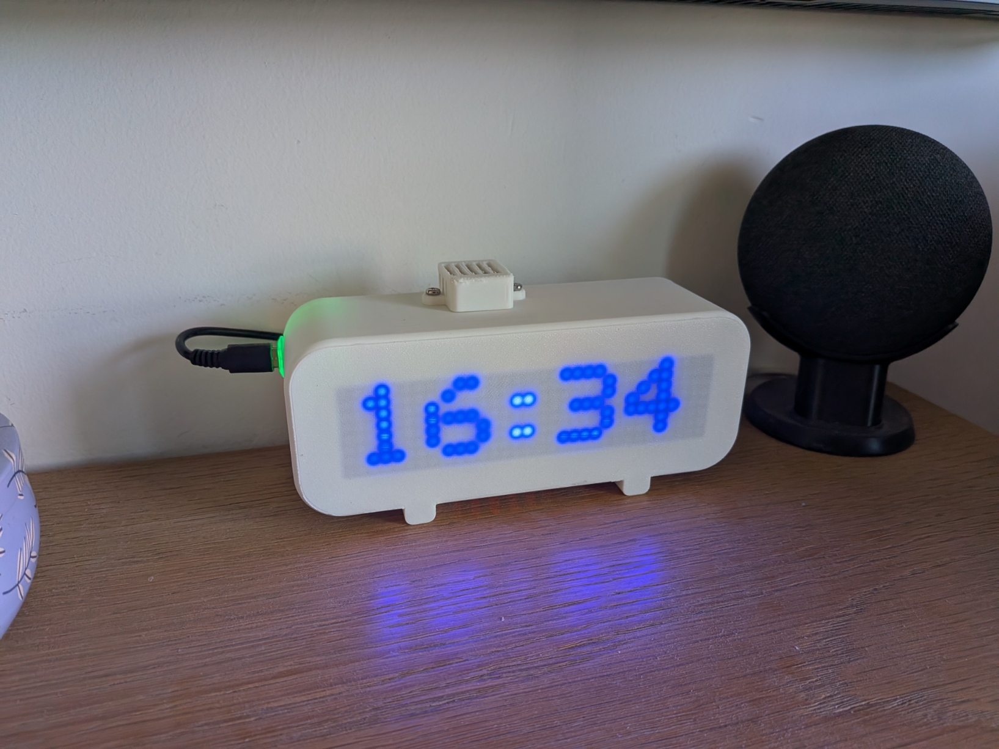
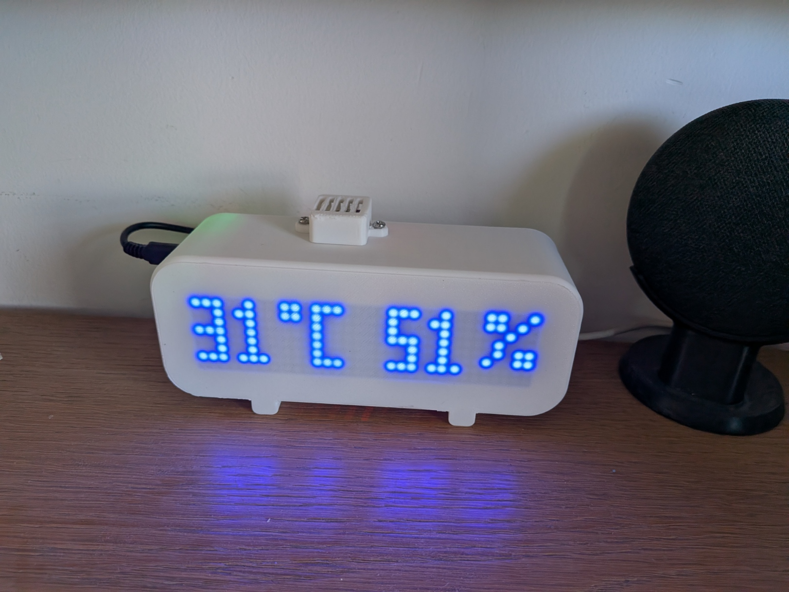
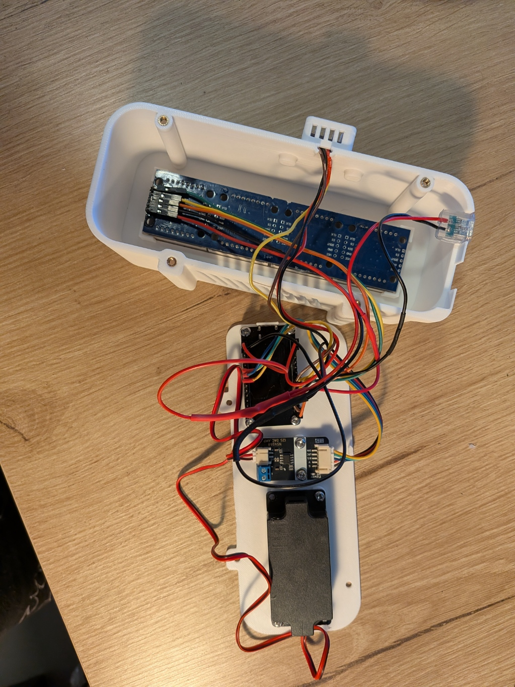
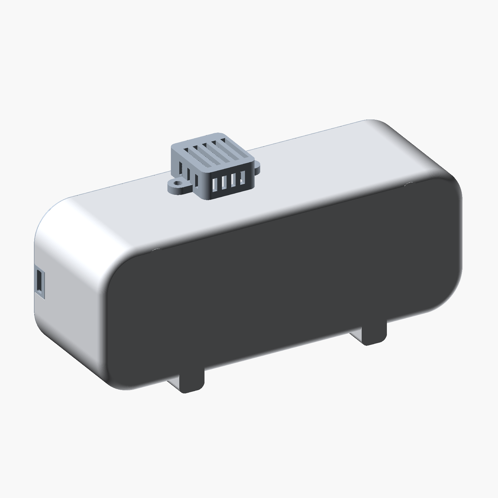
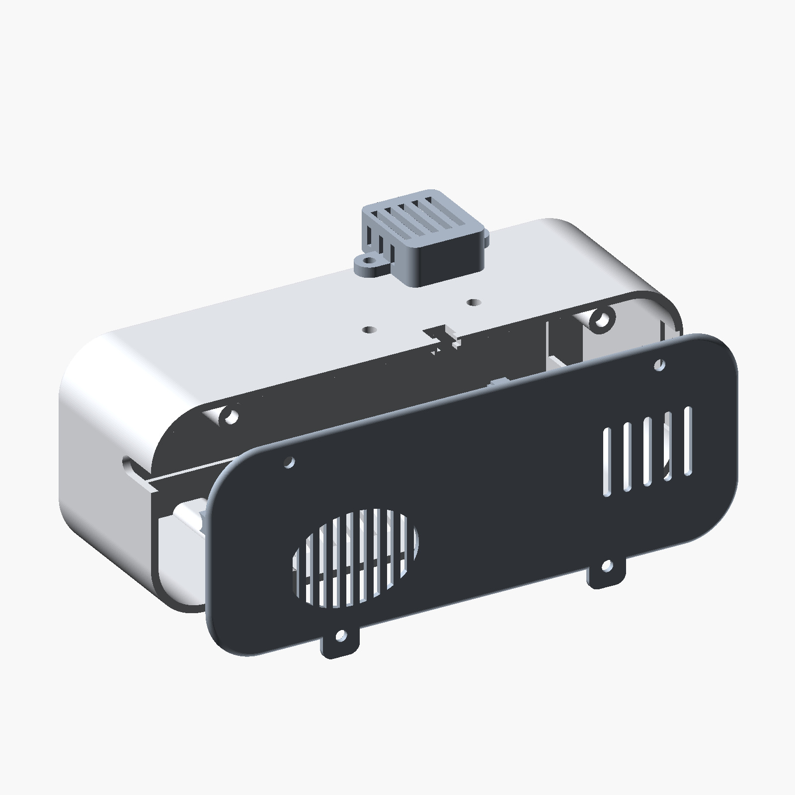
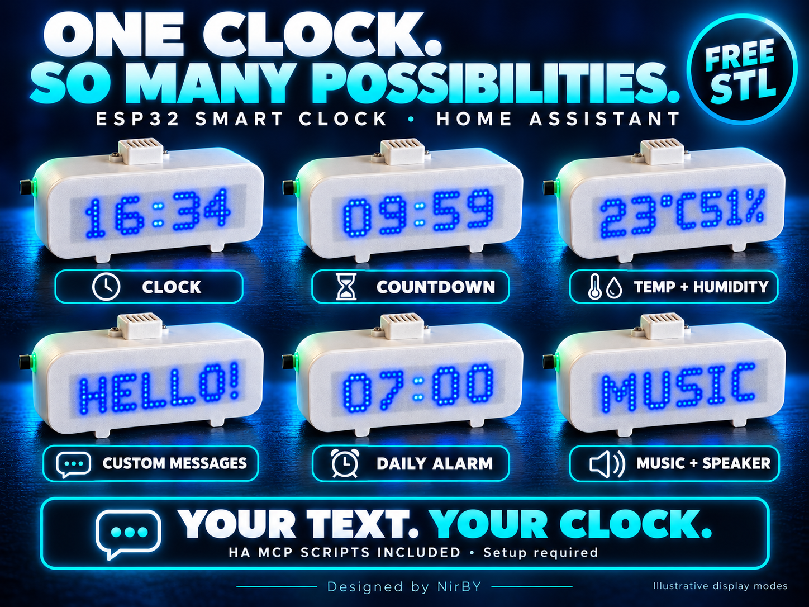
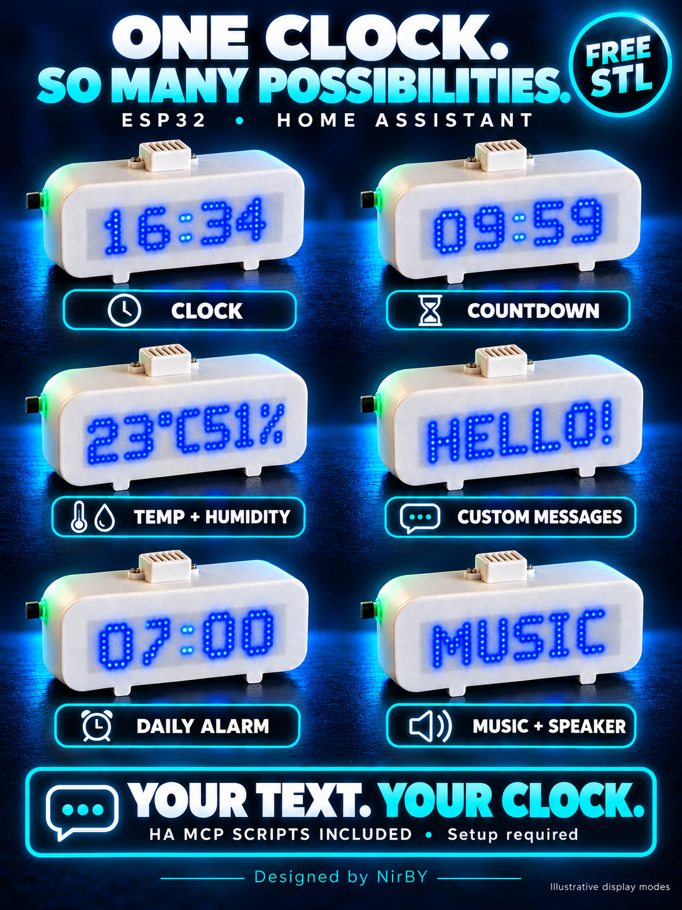

# Build gallery

## Feature presentation

The rotating gallery keeps the original eight feature panels and adds detailed
alarm-schedule and alert-sound slides. [Feature storyboard](../images/showcase-storyboard.png) · [Alarm schedules](../images/alarm-schedules.png) · [Alert sounds](../images/alert-sounds.png).

## Alarm schedules

Configure one alarm in Home Assistant: every day, selected weekdays, a day of
each month, or a specific date. Optionally limit it to an inclusive start/end
date range. The schedule summary shows your choices in readable text.

*Illustrated examples of the scheduling controls, not a live Home Assistant
screenshot. Choose one schedule at a time. The
[example dashboard](../home-assistant-dashboard.yaml) shows the relevant
weekday switches, day-of-month control, or date picker for your selection.*

See the [alarm setup and scheduling rules](Alarm.md). The clock displays
`ALARM`, plays the selected local Alarm Sound, and sends an event to Home
Assistant for additional automations.

## Alert sounds

Choose Silent, Single beep, Double beep, Classic alarm, Cuckoo or Timer melody.
That is five audible sounds plus Silent. Alarm, Hourly, Timer, Reminder and
Volume each have their own selection and sound-test button in the supplied
Home Assistant dashboard. These are local alert sounds, rather than speech
voices. See the [audio guide](Audio-And-Music.md#local-alert-sounds).

## Actual printed clock

## Geometry rendered from the final STLs

The enclosure opens at the **rear**: the vented rear lid detaches, while the
front diffuser remains part of the body. These views use the actual STL meshes.

GitHub also provides an interactive mesh preview when opening the
[body](../../ESP32_Smart_Clock_3D_Design/stl/body.stl),
[lid](../../ESP32_Smart_Clock_3D_Design/stl/lid.stl), or
[sensor cage](../../ESP32_Smart_Clock_3D_Design/stl/sensor_cage.stl).

## Promotional images

These are **AI-assisted retouches** of the creator's photographs, not new CAD
renders or exact electrical references. The original photos above and below
remain available. Use the [wiring diagram](Wiring.md) for electrical connections.
The six display modes are illustrative. MCP scripts require setup and live verification.
See [image provenance and prompts](../images/PROVENANCE.md).

## Components — retouched and original

| Component | Retouched image | Original photograph |
|---|---|---|
| LED matrix | [Image](../images/led-retouched.png) | [Original](../images/led-original.jpg) |
| Power socket | [Image](../images/usb-retouched.png) | [Original](../images/usb-original.jpg) |
| ESP32 board | [Image](../images/esp-retouched.png) | [Original](../images/esp-original.jpg) |
| Amplifier | [Image](../images/amp-retouched.png) | [Original](../images/amp-original.jpg) |
| Bench assembly | [Image](../images/bench-retouched.png) | [Original](../images/bench-original.jpg) |

The retouched close-ups can alter tiny printed lettering. Do not identify pins
from them. Photo enhancements were generated with the built-in ImageGen tool;
the supplied product shape and wire routing were requested to remain unchanged.
Image credit: NirBY. These project photos and derived promotional images are
licensed CC BY-NC-SA 4.0, matching the enclosure license. Existing unrelated
images retain their original licensing.
