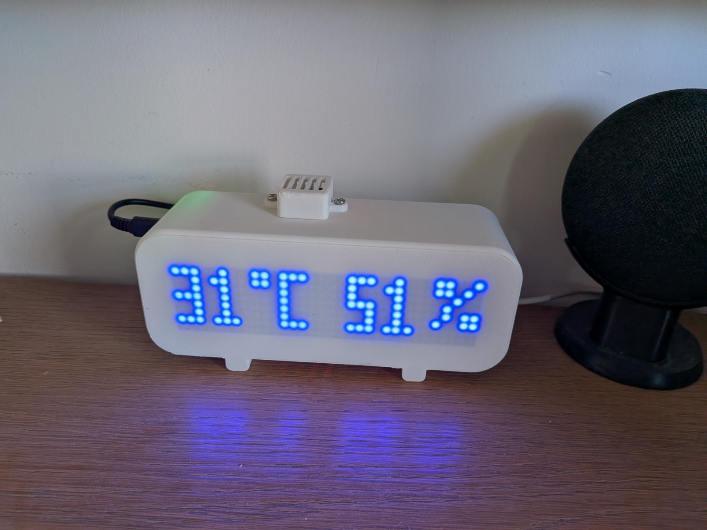
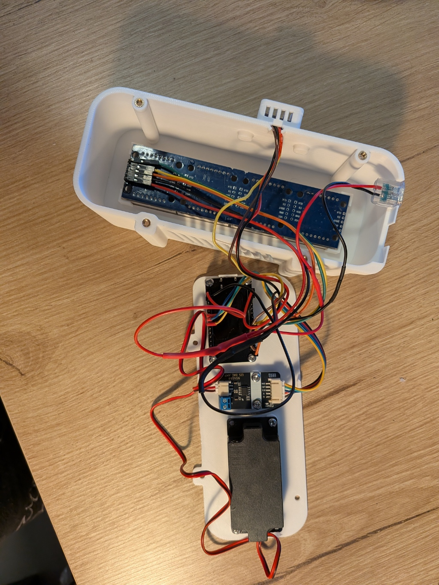
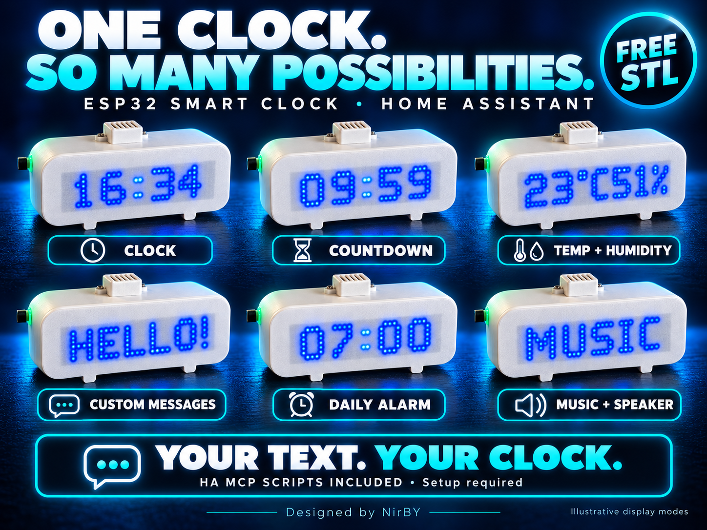
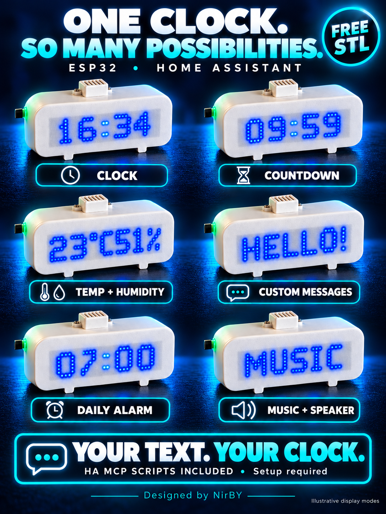

# Build gallery

## Actual printed clock

## Geometry rendered from the final STLs

GitHub also provides an interactive mesh preview when opening the
[body](../../ESP32_Smart_Clock_3D_Design/stl/body.stl),
[lid](../../ESP32_Smart_Clock_3D_Design/stl/lid.stl), or
[sensor cage](../../ESP32_Smart_Clock_3D_Design/stl/sensor_cage.stl).

## Promotional images

These are **AI-assisted retouches** of the creator's photographs, not new CAD
renders or exact electrical references. The original photos above and below
remain available. Use the [wiring diagram](Wiring.md) for electrical connections.
The six display modes are illustrative. MCP scripts require setup and live verification.
See [image provenance and prompts](../images/PROVENANCE.md).

## Components — retouched and original

| Component | Retouched image | Original photograph |
|---|---|---|
| LED matrix | [Image](../images/led-retouched.png) | [Original](../images/led-original.jpg) |
| Power socket | [Image](../images/usb-retouched.png) | [Original](../images/usb-original.jpg) |
| ESP32 board | [Image](../images/esp-retouched.png) | [Original](../images/esp-original.jpg) |
| Amplifier | [Image](../images/amp-retouched.png) | [Original](../images/amp-original.jpg) |
| Bench assembly | [Image](../images/bench-retouched.png) | [Original](../images/bench-original.jpg) |

The retouched close-ups can alter tiny printed lettering. Do not identify pins
from them. Photo enhancements were generated with the built-in ImageGen tool;
the supplied product shape and wire routing were requested to remain unchanged.
Image credit: NirBY. These project photos and derived promotional images are
licensed CC BY-NC-SA 4.0, matching the enclosure license. Existing unrelated
images retain their original licensing.
