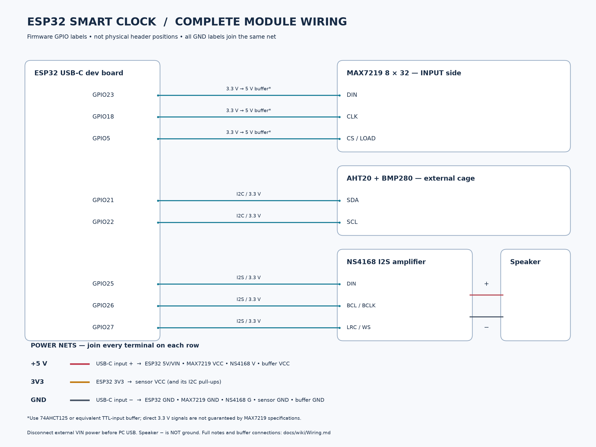

# Full wiring — ESPHome clock

[Vector diagram](../images/wiring.svg). Signal assignments are taken from
`esphome-smart-clock.yaml`. Connections below are to **module labels**, not to
universal physical header positions. The photo wire colors are not a pin map.

| Source | Destination | Connection |
|---|---|---|
| Regulated USB-C input +5 V | ESP32 5V/VIN, MAX7219 VCC, NS4168 V | Parallel 5 V supply bus |
| Input GND | ESP32 GND, MAX7219 GND, NS4168 G, sensor GND | Common ground bus |
| ESP32 3V3 | Sensor VCC | 3.3 V only |
| ESP32 GPIO21 | Sensor SDA | I2C data |
| ESP32 GPIO22 | Sensor SCL | I2C clock |
| ESP32 GPIO23 | MAX7219 DIN | Via 3.3→5 V buffer for guaranteed logic levels |
| ESP32 GPIO18 | MAX7219 CLK | Via buffer |
| ESP32 GPIO5 | MAX7219 CS / LOAD | Via buffer; GPIO5 is a boot strapping pin |
| ESP32 GPIO25 | NS4168 DIN | I2S audio data |
| ESP32 GPIO26 | NS4168 BCL / BCLK | I2S bit clock |
| ESP32 GPIO27 | NS4168 LRC / WS | I2S word clock |
| NS4168 speaker + | Speaker + | Amplified output |
| NS4168 speaker − | Speaker − | Amplified output, **not GND** |

The four display tiles are already chained on the matrix PCB. Connect to its
**DIN input** end; leave the final DOUT unconnected. The sensor board combines
AHT20 (0x38) and BMP280 (configured 0x77) on the same SDA/SCL pair. Its I2C
pull-ups must go to 3.3 V, never 5 V.

The working prototype uses direct display signal wires. At 5 V, however,
[MAX7219 specifies a 3.5 V minimum logic-high input](https://www.analog.com/media/en/technical-documentation/data-sheets/MAX7219-MAX7221.pdf),
so ESP32 3.3 V outputs are outside that guaranteed threshold. For a reproducible
build, use a 5 V 74AHCT125 buffer: GPIO23→1A / 1Y→DIN, GPIO18→2A / 2Y→CLK,
GPIO5→3A / 3Y→CS; enable those channels by tying their active-low OE pins to
GND. Connect buffer VCC to 5 V, GND to common GND, and decouple with 100 nF.
Tie unused inputs to a defined level and disable their outputs. Check the
chosen IC/package datasheet for actual pin numbers. This extra buffer is not
present in the prototype photos or guaranteed to fit a dedicated mount.

Use only regulated 5 V input; this socket is not a battery charger. Verify its
wire polarity and voltage before connection. Do not connect 5 V to ESP32 3V3
or sensor VCC. Never connect either amplified speaker terminal to ground.
Keep the sensor outside the enclosure in its vented cage.

Disconnect external 5 V from ESP32 VIN before powering the ESP32 from PC USB,
unless the exact board has verified power-path isolation. For normal operation
use the common external 5 V supply and OTA. See [Hardware and Power](Hardware-And-Power.md)
for optional bulk capacitance and power troubleshooting. The supplied photos
are build references, not evidence that every hidden electrical connection is
correct. Follow the explicit pin map above.
